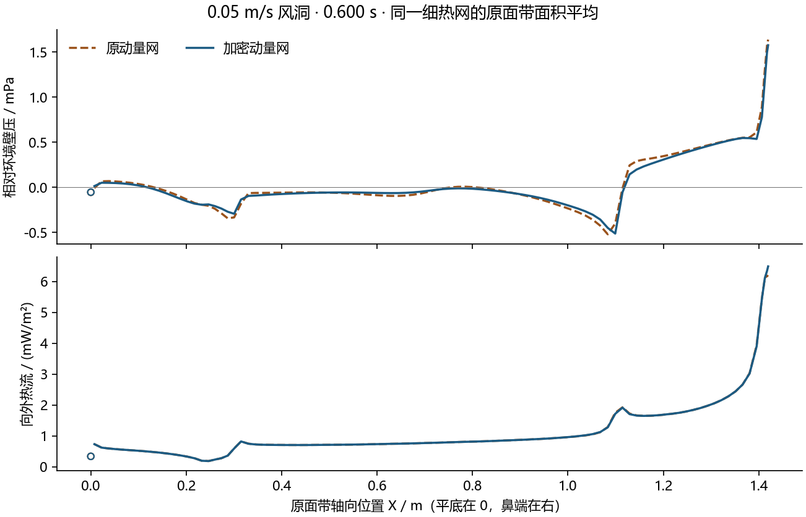
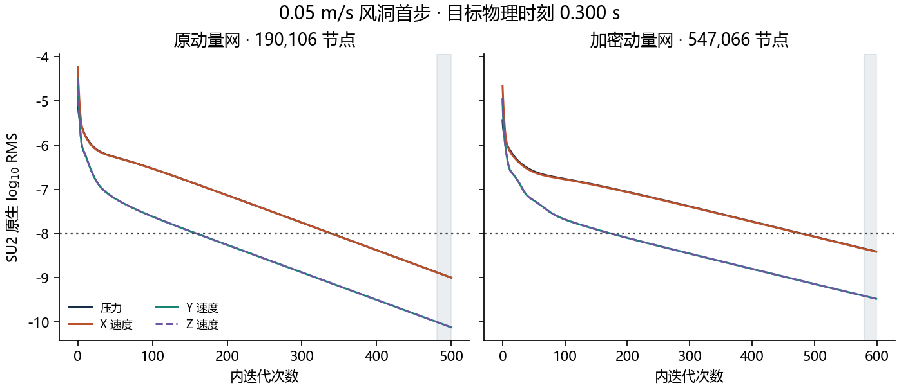

# 0.600 s 低速风洞动量网格敏感性

**同一张细热网、同一温度初场上，动量网加密使整件向外放热从 0.868870422 mW 变为 0.868242605 mW。** 以加密结果为分母，两者相差 0.0723%。同一批 9,216 原面的壁压加权 RMS 差为来流动压的 2.361%，热流加权相对 RMS 差为 0.741%。整件、六区功率及鼻端热峰通过事前门槛。计算覆盖相对 v356 净增为壁压、热流及二者交集各 **0 面、0 m²**，新增面号集合为空。本轮量化的是已有全表面结果对动量离散的敏感性。该工况的联合实测验证面积仍为 0 m²。[逐面结果包](../../../cases/simple_launcher/wake/momentum_grid.zip) · [数值核对](fields.json)

| 区域 | 原动量网放热 µW | 加密动量网放热 µW | 区域放热差 | 区域壁压 RMS 差 / 来流动压 |
|---|---:|---:|---:|---:|
| 球形鼻端 | 15.695 | 15.825 | 0.823% | 7.085% |
| 锥形头罩 | 268.002 | 267.603 | 0.149% | 3.530% |
| 圆柱箭身 | 503.697 | 503.407 | 0.058% | 2.082% |
| 收缩肩 | 17.073 | 17.061 | 0.069% | 3.252% |
| 尾段 | 57.564 | 57.508 | 0.099% | 1.286% |
| 平底 | 6.839 | 6.838 | 0.003% | 0.098% |

局部变化集中在鼻端。鼻端最大向外热流由 6.193 变为 6.489 mW/m²，差 4.55%。原网峰值位于 9102 号面（X = 1.415646–1.419197 m），加密网峰值位于 9126 号面（X = 1.419197–1.420420 m），移到最靠近尖端的相邻面带。球形鼻端的壁压 RMS 差达到来流动压的 7.085%；事前 5% 的壁压门槛用于全表面积分。新网绝对压力减环境值的范围为 −0.545 至 +1.575 mPa。[比较算法](compare_fields.py)

## 固定工况与网格

基线为 v356（`4b06dbc09795fc33a99e74fc9f303ac5feeee20f`）。试件为简化箭体，零攻角、0.05 m/s、空气 300 K、给定等温壁 300.001 K。外域半径 14D、48 个方位和原 STL 的 9,216 面均相同。沿壁 108 个间隔全部二分，原 36 个离壁间隔中的内侧 16 个二分。外界新增点位于原有弦段，原壁、原远界和原子午折点均有对应节点。实际体积相对变化约 1×10⁻¹⁵。原面计量面积为 0.935516891 m²，4,656 个原壁面带与方位扇片的最大相对面积差为 4.08×10⁻⁷ 以内。[运行合同](PLAN.md) · [建网及初场](refine_flow.py)

| 动量网指标 | 原网 | 加密网 |
|---|---:|---:|
| 三维节点数 | 190,106 | 547,066 |
| 体单元数 | 186,624 | 539,136 |
| 沿壁边长中位数 | 15.606 mm | 7.803 mm |
| 首层法向高度中位数 | 0.464 mm | 0.231 mm |
| 第一条离壁射线边长中位数 | 0.960 mm | 0.480 mm |

两份速度种子取自 v352 原文件，新增节点按原三角形的边和对角线插值。独立核对了所有 190,106 个共有节点的坐标和两份实际初始场；新增节点不重新归一化尾迹扰动。热网、温度初场及两次 0.300 s 的步长沿用 v356。两种动量离散在热网三角形重心处对同一控制种子的速度插值仍有差异，最大为来流速度的 1.0313%。传递程序在相同取样位置显式计入该差额。此次对照包含初场在两种离散上的表示差异。[速度传递](heat_on_flow.py)

## 两个真实动量时间层

SU2 8.6.0 在两个物理时间层各执行 600 次内迭代。首步末 20 行的最大 log RMS 分别为压力 −8.346、X 速度 −8.351、Y 速度 −9.415、Z 速度 −9.415，第二步为 −8.637、−8.643、−9.686、−9.686。两步壁面速度均为零、绝对压力为正，输出坐标与已核对体网相符。第一步实际耗时 602.86 s、峰值 3.30 GiB，第二步耗时 570.13 s、峰值 3.06 GiB。原生进程正常结束，两个完整终帧、重启种子及残差历史均已核对指纹。[原生终态与建网回执](flow_evidence.json)

## 原面取样

对于侧面，先按原三角面的对角线方向剖分加密壁面，再将子三角形裁到该原面并积分线性形函数；平底保留扇片完整径向范围，按分段线性压力乘半径积分。常值权重逐面求和为 1，以三坐标作仿射场核对，原面重心最大位置差为 6.70×10⁻⁹ m。两套网格在原始控制种子上的 9,216 个绝对压力读数逐面相同。热流由共同细热网的等温壁反力保守映射。首层温度按各自真实动量网的首层节点位置读取，两种采样距离在探针中分别注明。[原面面积积分](wall_sampling.py)

把加密网所得压力限制到原有节点、用 v356 的原取样算法与原网比较，差为来流动压的 2.307% RMS。保持加密压力帧，只改变两种原面取样算子，差为 0.908% RMS。这两个 RMS 描述不同对照。最终 2.361% 直接来自两套原面表。加密动量首层流体温度范围为 300.000879–300.000999 K，给定壁温为 300.001 K。

末热步的壁面放热为 **868.242605 µW**，远界净显热流出 **866.981512 µW**，流体储热率为 **1.261092 µW**。从相邻两个全周温度场独立积分恢复该储热项。两次热步的温度都在原无量纲 [0,1] 内，原方程相对残差均低于 2×10⁻¹⁵。两个热步分别耗时 47.55 s 和 52.53 s。使用本机已经接受的同源动量历史时，日常主结果仍按 v356 的入口新算，网格对照按源身份配对读取。周向仍固定 48 格，仅有两个物理时间层，底面微弱一阶热信号的时间辨识限制继续保留。外域距离和同形实验精度待核对。

## 复算

普通侧栏“读档”和“计算”均已实跑，从点击到出图分别为 8.11 s 和 124.94 s。每种模式各核对了 12 个场量的 9,216 行导出、六区拾取、X=0.7 m 的 96 行截面及压力／热流联合表。选择“相对环境壁压 · 加密动量网”和“入壁热流 · 加密动量网”即可查看对照。[工作台回执](workflow.json) · [本机三维页](../../../outputs/v357_validation/ui_solve01/workbench/index.html)

使用 `refine_flow.py` 对一个新的 `outputs/v357_validation` 子目录依次执行 `prepare`、`first` 和 `second`，后一步读取前一步的原生终态。用 `heat_on_flow.py` 在该目录执行 `sampling`、`1`、`2`，然后用 `compare_fields.py` 打包。这一路径需要已核对的 v350 基流、v352 全周种子及 v355 热网与初温，本次完整体场位于本机 `outputs/v357_validation/run01`。Git 收录完整原面表、代码及小型证据。以保留的 v352 默认入口在空目录重建后，原体网、两份速度种子和测站文件的四项指纹全部相同。[界面回归合同](WORKBENCH.md) · [下一项](NEXT_DECISION.md)
