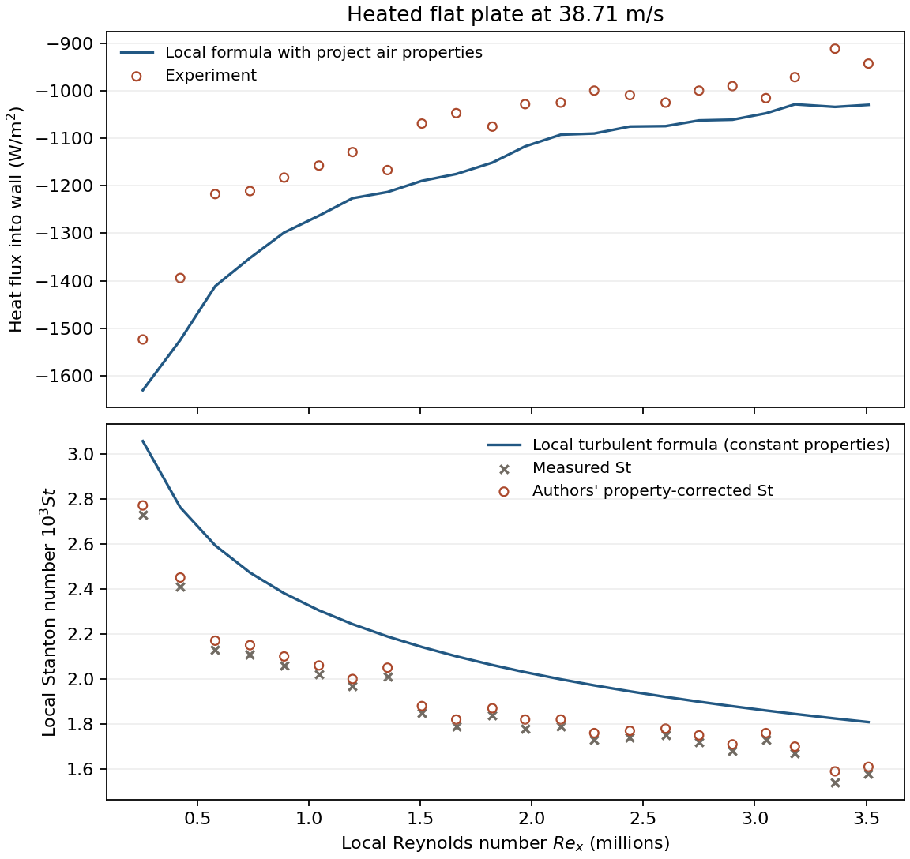

# 有温差亚声速平板的逐站热流对照

**按论文最高速度档的全部 22 个测站核对，项目局部湍流换热公式给出的放热方向全部正确，放热强度逐站平均高估 8.48%，相对误差均方根为 9.01%，最大高估 15.91%。** 本轮采用这组实验检验零压梯度、已转捩的附着平板局部换热，保留 22 个实测值、计算值和有符号偏差。外形弯曲、流向压力变化、分离、再附和底面均超出这组测量。M0.30 仍缺本工况内部求出的外流及已通过验证的动量入口，整件热功率未知。新增计算壁压、热流及同面覆盖各为 **0 面、0 m²**，三项新增面号集合均为空，总面积 0.935516891 m²。[逐站热流](plate_heat.csv) · [实验原表](https://ntrs.nasa.gov/citations/19980228020) · [五个飞行工况](../v358/RESULTS.md)

## 试验到底测了什么

Reynolds、Kays 和 Kline 在 1958 年 NASA Memo 12-1-58W 的表 I(a) 给出了八档气流的分条换热数据。此次取最高标称速度 127 ft/s（38.71 m/s，约 M0.11），采用表内全部第 2 至第 23 条铜带。24 条独立加热铜带从平板前缘起布置，受热段长 60.50 in。第一条上的胶带触发转捩，论文报告典型试验中板面大部分位置的来流湍流度约为 2%–3%。研究对象为光滑、近零流向压力梯度的湍流平板。站位采用原铜带编号和作者给出的当地 Re_x。[原文印刷页 15–18、24、29，图 3(b)](https://ntrs.nasa.gov/api/citations/19980228020/downloads/19980228020.pdf)

该档自由流温度为 303.21 K，各铜带平均壁温 315.54–316.32 K。由于独立供热和横向散热，计算按站读取实测温差。作者从输入电功率扣除背侧和端部损失、辐射及条间传导，按平均温差给出换热系数。按国际表 Btu 换算，测得的**入壁热流**为 −1,523.67 至 −911.68 W/m²；表内换热系数乘温差与印刷热流最大差 0.562%。这个差值用于检查列、倍率与单位。文中给出的局部 St 和 Re_x 的概然误差分别为 ±3% 和 ±1%；该不确定度定义不能直接赋给每个有量纲热流或飞行原面。[原文印刷页 16–17、24](https://ntrs.nasa.gov/api/citations/19980228020/downloads/19980228020.pdf) · [逐行转录及 PDF 指纹](table_ia_127.json)

## 两种误差分别回答什么

| 在 22 个站位比较的量 | 测量参照 | 平均相对偏差 | 相对误差均方根 | 最大绝对相对偏差 |
|---|---|---:|---:|---:|
| 入壁热流，W/m² | 原表扣除热损失后的对流热流 | +8.48% | 9.01% | 15.91%，第 4 条 |
| 定物性极限的局部 St | 作者作温度物性修正后的 St | +11.46% | 11.87% | 19.47%，第 4 条 |

热流一行按逐站的“计算放热强度 / 实测放热强度 − 1”计算，再对 22 条铜带等权统计。第 4 条实测入壁热流 −1,217.67 W/m²，计算 −1,411.46 W/m²；最小强度偏差也为 +3.15%。计算采用表中各站的质量通量及该档来流密度恢复速度，采用实验确定的湍流身份、当地 Re_x、壁温和空气温度。湿空气以项目干空气物性近似。MATLAB 实际调用了项目的恢复温度、Eckert 参考焓温度及焓差比热函数，在该平板上按现行局部湍流公式计算热流，再以直接焓差交叉核对。未拟合系数。测得的热流仅用于比较。[MATLAB 完整读表程序](check_plate_heat.m) · [局部热流在主程序中的位置](../../../calcSurfaceHeating.m)

St 一行只检查现有局部公式的定物性极限，使用论文按来流定义的 Re_x 和项目默认 Pr = 0.72。若改与作者未经物性修正的 St 比较，平均相对偏差为 +13.51%。热流一行则用参考态 Re 和恢复温差，直接比较 W/m²。两种读数采用的温度和归一化各有定义。表 I(b)、I(c) 的剖面另有来流速度，未与 127 ft/s 热流表拼成同一工况。[原始量及误差明细](comparison.json) · [Python 独立核对](compare_plate.py)

## 和 M0.30 的关系

| 对象 | 热边界、流态与证据 | 采用或拒绝 |
|---|---|---|
| 本次平板 | 空气 38.71 m/s，铜带比空气高 12.33–13.11 K；Re_x 为 0.255–3.51 百万；首条强制转捩；22 站局部放热 | 采用为已转捩附着区局部换热公式的独立试件对照。不能给飞行圆柱段直接授予计算或实验面积 |
| 已收录 Short Test 65 | 空气 1.2375 m/s，直径 Re = 882；银球平均表温 352.93 K，来流 310.99 K；球身量热功率及七个极角的局部 Nu，局部误差条未知 | 保留球形试件自己的验证；来流、雷诺数和带支管边界与目标鼻端不同 |
| 已收录 B 型热敏珠 | 空气 3 m/s，约 12 K 温差；项目按横径给出 Re = 180.10；图 7 是整珠平均换热系数；该点实验不确定度未知 | 保留整珠平均量对照，无法约束沿箭身的局部热流 |
| 目标简化外形 | 空气 96.16 m/s、255.68 K、给定壁温 300 K；Re_D = 1.044 百万、Re_L = 6.178 百万。自然转捩位置、局部外缘和壁剪切尚缺，收缩肩后可能分离 | 圆柱上的附着区是这类方法将来可能使用的区域。本轮没有任何原面取得外缘、局部 Re 或附着资格。鼻端、肩部、尾段和平底继续按自身物理条件验收 |

平板来自实验的局部 Re_x 不能与飞行模型的直径或全长雷诺数互换。现成 MATLAB 通用入口在 M≤1 时于来流阶段退出；即使已经知道热壁放热的方向，也没有足以计算具体面元热流的本地输入。v359 亚声速平板动量对照的两项摩擦偏差 5.27%/6.79% 与 ω 残差未通过的结论继续有效。五个飞行点的原面结果和最终云图资格沿用 v358。[M0.30 量纲与动量核对](../v359/RESULTS.md) · [银球原始测量定义](../v321/SOURCE.md) · [热敏珠与图读不确定度](../v282/RESULTS.md)

## 复算和交付

基线为 v359，提交 `46a5dd031be611b748f1cf57a366c6c98c2769f0`。在 MATLAB 项目根目录执行 `addpath('docs/validation/v360'); rows = check_plate_heat();` 可得到本轮 22 行结果。Python 在根目录执行 `python docs/validation/v360/compare_plate.py` 可从发布的原表与 MATLAB 表独立检查逐站单位、符号与误差。MATLAB 含启动耗时 20.61 s，22 站模块读回为 0.905 s，峰值常驻内存约 533 MiB；监督记录为正常终态且输入指纹稳定。最终 Python 来源与结果核对、绘图合计 1.08 s。本轮 CFD 用时为零。资料和代码核对在登记的 30 分钟内完成。[MATLAB 运行回执](matlab_run.json) · [事前计划](PLAN.md)

Git 保存原表转录、运行回执、读表程序、逐站表和比较图。本机 `outputs/v360_validation/sources` 保存来源 PDF 与核读页图；可从 NASA 的固定记录取回并用转录文件中的 SHA-256 校验。MATLAB 原始输出保存在 `outputs/v360_validation/process_plate01`。本轮只变更这个对照及项目交接记录。[下一项](NEXT_DECISION.md)
