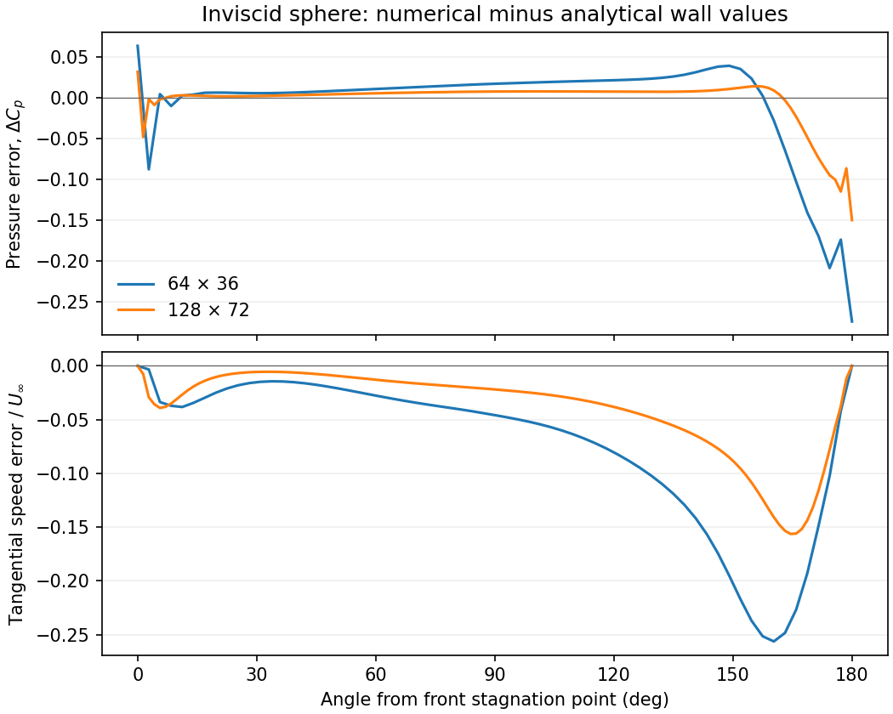

# 亚声速外流候选的动量核对及工作台入口

**M0.30 的低亚声速无黏候选尚未获得原面计算资格。** 固定 SU2 8.6.0 的两套独立球体计算均正常收敛。加密后压力系数的最大绝对误差由 0.275 降到 0.150，仍超过 0.10；切向速度均方根误差由来流速度的 8.74% 降至 4.42%，门槛为 3%。最大压力误差都出现在后驻点。按事前决定关闭这组测试。简化箭体本工况没有启动整件试算，9,216 面、0.935516891 m² 上新增计算壁压、热流及两者交集各为 **0 面、0 m²**，三个新增集合均为空。整件热功率未知。[原定门槛](PLAN.md) · [加密前登记的条件](GRID_CHECK.md)

## 在工作台中查看

载入简化模型并确认风洞边界后，在第 4 步选择“查看该模型的飞行工况记录”。同一侧栏可切换 M0.30、0.85、1.00、1.20 和 2.00。记录与当前 STL 指纹、网格面数和面积对应。页面列出来流、给定壁温、计算壁压、工程热流、两者同面及给定压力。M≤1 的三条记录显示“未返回面场”；两条返回了工程值的记录显示实际面数、面积占比、原算法及适用范围。M0.30 附有本次球体加密网的核对结果。五点的整件热功率均未知。[飞行工况原始记录](../v358/evidence/cases.json) · [完整工作台文件](../../../rocketAeroHeatWorkbench.m)

浏览只读取已有记录。MATLAB 常规入口的实际操作核对了五次切换期间的工况、输入版本、求解编号、结果页资格，以及三项面积和给定压力。返回后仍可按原先确认的 0.600 s 风洞工况，读取 9,216 面的完整结果。初版侧栏核对耗时 44.42 s；添加方法说明后，一次测试在读取多段压力适用说明时发现字符串类型不匹配，26.06 s 后以错误退出。已修正并重测五个工况和返回读档，最终通过耗时 33.89 s、峰值常驻内存 1.70 GiB。两份源回执、失败日志与最终回执均保留在本机对应测试目录。本次核对覆盖实际控件与结果状态，沿用 v357 对既有 WebGL 探针、截面和三维页的验收。[界面读回](workbench.json) · [工作台回归程序](check_flight_review.m) · [原三维页验收](../v357/RESULTS.md)

## 球体动量对照

滑移球半径 0.5 m，远界半径为 14 个直径。来流沿 −X，速率 1 m/s，密度 1 kg/m³，远界表压 0 Pa。求解器关闭能量方程。对照为均匀无界来流中无旋、不可压的球体解析解，极角从迎风驻点起算。在球壁上，切向速率与来流速率之比为 1.5 sin θ，由伯努利关系得到 Cp = 1 − 2.25 sin² θ。两者分别同末帧的切向投影和表压比对。球环按相邻极角余弦之差加权，两端极点也纳入最大误差。该项属于解析校核，未使用实验热流或壁温。[固定配置](sphere.cfg) · [建网、监督与读回](check_sphere.py)

| 指标 | 原网 64×36 | 加密网 128×72 | 事前门槛 |
|---|---:|---:|---|
| Cp 面积加权 RMS 误差 | 0.02847 | 0.01114 | < 0.04 |
| Cp 最大绝对误差 | 0.27472 | 0.15007 | < 0.10 |
| 切向速度 RMS 误差 / 来流速度 | 0.08740 | 0.04417 | < 0.03 |
| 迎风驻点 Cp | 1.06411 | 1.03213 | 解析值 1 |
| 背风驻点 Cp | 0.72528 | 0.84993 | 解析值 1 |
| 赤道 Cp | −1.23249 | −1.24202 | 解析值 −1.25 |
| 末 20 行压力、轴向及径向速度最大 log RMS | −11.33 / −9.88 / −10.54 | −10.11 / −9.72 / −9.67 | 三项均 < −8 |
| 实际迭代次数 | 1,141 | 2,511 | 最多 3,000 次 |
| 原生运行耗时 | 4.16 s | 34.88 s | 各在登记上限内 |

球壁最大法向速度分别为 3.2 × 10⁻¹⁵、7.3 × 10⁻¹⁵ m/s。按远界节点速度和球环面积重建的净体积流量，以来流速度乘球体迎风截面积归一化，分别为 −1.565%、−0.209%。这是对导出速度的边界求积；原生数值通量的同阶段守恒账及外域尺寸敏感性未核实。加密使误差缩小，两张网不足以证明收敛阶，也无法区分离散通量、壁面离散和有限远界各自的作用。无黏球尾的压力差不代表真实流体发生分离。[原网回执](sphere.json) · [加密网回执](sphere_fine.json)

## 对当前飞行入口的决定

当前工作台通过几何指纹进入已验证的固定低速风洞计算。通用单工况入口使用激波与膨胀工程链，在来流阶段拒绝 M≤1。本轮核对了同机的恒密度无黏引擎、轴线/滑移壁/远界、原生变量和真实终态。此组合未通过完整球壁动量门槛，输出字段也只有坐标、表压及两速度分量。对 5 km、M0.30、零攻角、给定壁温 300 K 的试件，本轮没有可发布的外缘速度、温度、壁压或热流。旧 0.05 m/s 风洞场、22 站平板误差和旧黏性候选各自保持原来的工况归属。[单工况入口](../../../runAeroHeatSingleCase.m) · [有温差平板对照](../v360/RESULTS.md)

基线为 v360 提交 `e7b60c460a51786039b302008095c3b88ade887a`。两网均从均匀来流起算，初场、周期场、终帧及历史在 `outputs/v361_validation/sphere01` 和 `sphere02`。首轮实际执行的脚本保存在 `sphere01/executed_sphere.py`，读回时依据真实文件名使用 `restart_` 和 `surface_` 前缀。两份原生输出均核对了网格坐标、球壁节点、末帧全场与表面数值、输入指纹、正常退出及子进程清理。Git 收录两份球壁表、本轮脚本和轻量回执，大体场保存在本机。首网独立读回含 Python 启动约 0.70 s，文档编辑时间未计入运行耗时。[两网独立复算](compare_walls.py) · [下一项](NEXT_DECISION.md)

在项目根目录执行 `python docs/validation/v361/compare_walls.py`，可以只用 Git 中的两张球壁表复核两档共六项压力、速度误差及共同极角。重读本机完整原始场使用 `python docs/validation/v361/check_sphere.py read outputs/v361_validation/sphere02`。
