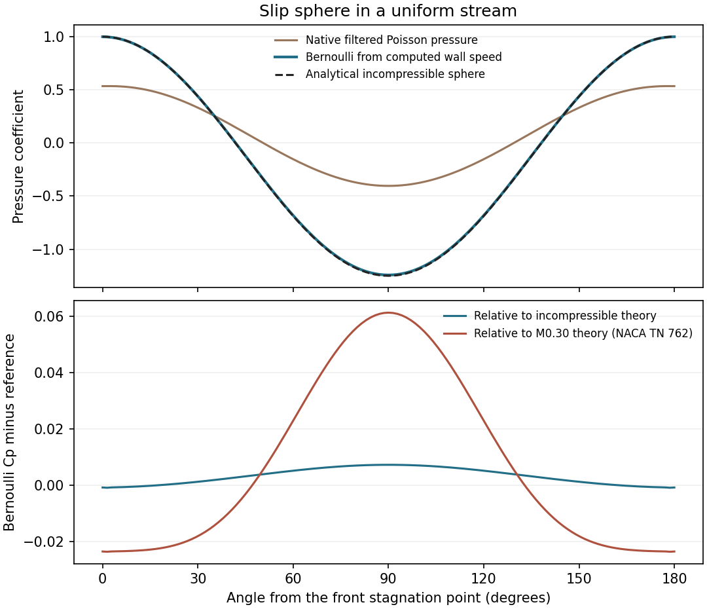

# 滑移球的速度势、两种壁压与 M0.30 对照

**在球体的 129 个共同极角上，OpenFOAM 13 求出的切向速度 RMS 误差为来流速度的 0.195%，用该速度计算的伯努利壁压最大 Cp 误差为 0.00728。** 两者通过上版门槛。该工具附加输出的泊松压力最大 Cp 误差为 **0.846**，未通过。采用前两项作为低速无旋附着外流的候选，并保留附加压力失败记录。将同一不可压解与 M0.30 的可压缩球体理论比较，最大 Cp 差增至 **0.06124**。这一步量化了模型近似对球体的影响。简化箭体本工况尚无已验收的原面压力或热流，相对 v361 新增壁压、热流及同面面积各为 **0 面、0 m²**，新增集合均为空，原分母 9,216 面、0.935516891 m²。整件热功率未知。[数值回执](sphere.json) · [可压缩对照](mach030.json)

## 两列压力各自的物理含义

球体直径 1 m、均匀来流 1 m/s、密度 1 kg/m³，外界半径 14 m，采用 128×72 个子午间隔和 ±1° 的轴对称楔形域。独立程序固定为 OpenFOAM 13 构建 `18870c24d21c`。核对过本机安装源码和官方同一提交的逐字指纹。它先由离散势方程修正面通量，再重建速度。壁速来自球面的滑移条件，程序后处理导出的壁压和三分量壁速与原生场独立读回一致。[输入合同](PLAN.md) · [原生求解源码](https://github.com/OpenFOAM/OpenFOAM-13/blob/18870c24d21c6b982e2cdec27b2f59738cca5f90/applications/solvers/potentialFoam/potentialFoam.C) · [运行身份](run_identity.json)

| 相对于不可压解析解的误差 | 128 个实际球环面心 | 129 个共同极角，含两极 | 门槛 |
|---|---:|---:|---:|
| 壁面切向速度 RMS / 来流速度 | 0.00184 | 0.00195 | < 0.03 |
| 伯努利压力 Cp RMS | 0.00495 | 0.00514 | < 0.04 |
| 伯努利压力 Cp 最大绝对误差 | 0.00694 | 0.00728 | < 0.10 |
| 原生泊松压力 Cp RMS | 0.57069 | 0.57080 | < 0.04 |
| 原生泊松压力 Cp 最大绝对误差 | 0.84558 | 0.84591 | < 0.10 |

伯努利压力使用从该解读出的壁速、给定的远场静压及来流动能，适用前提是稳态、无旋且总压一致。附加的 `-writep` 则用经流向过滤的源项解另一条压力泊松方程；本例给定远场表压为零、固壁压力法向梯度为零。极点从最邻两条面带外推，两个驻点的伯努利 Cp 约为 0.99923，泊松 Cp 约为 0.53458。赤道两列分别约为 −1.24272 和 −0.40409，解析值为 −1.25。两极与赤道的泊松误差方向相反，单一压力零点偏移无法消除。当前对照没有单独量化源项过滤与压力边界各自造成的偏差。[原始面带读数](sphere_wall.csv) · [读回及共同极角取样](read_sphere.py)

## 流量收支与存储核查

原生修正后的面通量逐面读回，并按每个体单元边界的实际朝向求和。9,216 个**流体体单元**中，最大绝对收支差为 2.71 × 10⁻¹⁴ m³/s；局部收支差除以该单元各面绝对通量之和，最大为 1.92 × 10⁻⁷。球壁和两个楔面总通量均为零。远界净流出为 7.63 × 10⁻¹⁷ m³/s，远界流入为 3.42015 m³/s。原生连续性误差为 1.84 × 10⁻¹³ s⁻¹。五轮势修正与五轮附加压力求解的各次末线性残差均小于 10⁻⁸。这个程序没有单独推进速度分量或能量方程，以上数值不构成黏性动量、能量或热流验证。[末场与残差](sphere.json)

首次在 E 盘 Windows 工作目录运行时，大小写不同的速度势 `Phi` 和面通量 `phi` 落在同一个文件，程序报正常退出，无法从首轮末场重建流量账。改在 E 盘 WSL 虚拟磁盘内的 ext4 独立目录重复原输入；两个文件具有不同 inode、数值类和单位。两次的初场文件、网格、配置与保存的速度、泊松压力、速度势均逐字相同。初场文件中速度为均匀来流；原生工具读入后将内部速度清零、施加速度边界，再求速度势。零时刻是工作目录标签，该稳态工具没有独立的物理时间层。首轮原件与两次全部回执均保留。[恢复决定](RECOVERY.md) · [两次输入输出与源版本](run_identity.json)

## M0.30 的球体参考

按 NACA TN 762 印刷页 8、9 的式 (17)、(23)，取该文的空气 γ=1.408，保留到 M⁴ 的速度项。M0.30 的赤道速率比独立复算为 1.531056，二阶近似为 1.528176，分别与表 I 的 1.53106 和 1.52818 在印刷精度内一致。该文对无黏球流作理论展开，没有给出同工况实验误差条。[NACA 原文](https://ntrs.nasa.gov/citations/19930081579) · [复算程序](check_reference.py)

| 129 个共同极角的比较 | 切向速度 RMS 差 / 来流速度 | Cp RMS 差 | Cp 最大差 |
|---|---:|---:|---:|
| 不可压解析解与 M0.30 文献理论 | 0.01826 | 0.03184 | 0.05397 |
| 本次不可压数值解与 M0.30 文献理论 | 0.01981 | 0.03630 | 0.06124 |
| 文献 M² 与 M⁴ 近似的差 | 0.00151 | 0.00419 | 0.00829 |

球体赤道的 M0.30 理论压力系数为 −1.30397，数值不可压解低估了这里的吸力。表中最后一行只度量两种展开阶数的差异。球体研究不支持将该误差直接赋给实际圆柱段，也无法给出收缩肩、尾段或平底的附着状态和壁面热流。[M0.30 逐项核对](mach030.json)

## 工作台与复算

在第 4 步“查看该模型的飞行工况记录”选择 M0.30，可以查看两种压力的资格和与 M0.30 理论的差额。对五个档案的实际切换、当前工况保持、结果页权限及返回风洞 9,216 面读档均已复测。两种压力结论只出现在对应记录中。工作台回归耗时 36.52 s。ext4 重算的建网、网格检查、求解和原生边界导出分别耗时 0.77、0.77、0.77、0.79 s（含进程监督），首轮 Windows 挂载目录另计。源码阅读和文献核对用时未计入求解耗时。[界面回执](workbench.json) · [完整工作台文件](../../../rocketAeroHeatWorkbench.m)

基线为 v361 提交 `6c09339e25390bee4489830d35fc17b18d79a802`。Git 收录完整球壁表、程序和小型证据。本机首轮文件在 `outputs/v362_validation/sphere01`，可压缩理论原文在 `outputs/v362_validation/sources`。区分大小写的最终全场位于 WSL 的 `/home/rah/.cache/RocketAeroHeat/v362_validation/sphere02`，虚拟磁盘位于 E 盘项目下。完整体场未另行上传。在项目根目录执行 `python docs/validation/v362/check_reference.py` 即可用已发布的面带表复核数值和文献比较；在该 WSL 环境中执行 `python3 docs/validation/v362/read_sphere.py /home/rah/.cache/RocketAeroHeat/v362_validation/sphere02` 可独立重读完整原生场。[生成与监督程序](sphere_case.py) · [下一项](NEXT_DECISION.md)
