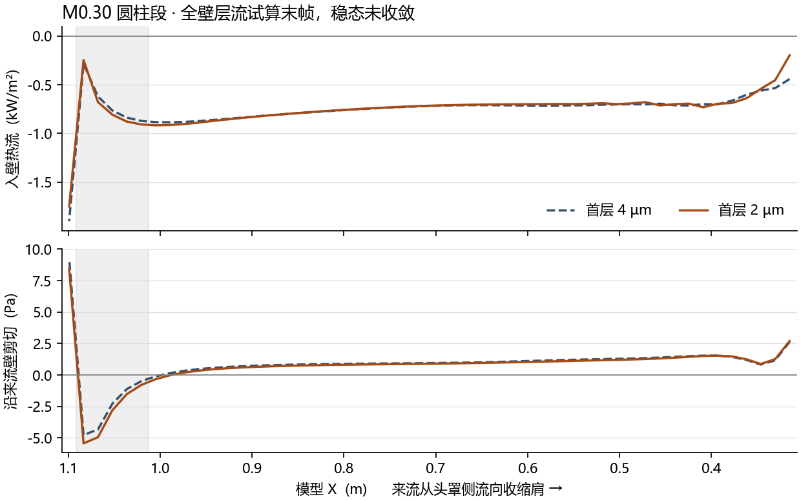

# M0.30 圆柱段的等温壁热流与近壁反向区

**在同一民用试件上，两档含黏性和能量方程的试算都给出了圆柱段热流，并在头罩下游识别出相同的 480 个近壁反向原面。** 两档末帧的圆柱段向外放热分别为 452.38 W 和 448.25 W。整段积分相差 0.92%，局部热流的面积加权 RMS 相对差为 6.06%，超过事前的 5% 门槛。两档的稳态残差和连续窗口热稳定性也未通过。这些值保留为固定全层流假设下的诊断，飞行点最终热功率仍未知。[计划](PLAN.md) · [原生结果核对](research/runs.json) · [两档原面读数](research/surface.json)

横轴沿来流由头罩向收缩肩展开，灰色带表示两档末帧共同出现壁剪切和首层速度反向的完整原面。原面平均值来自子午节点到三角面的面积积分。图上每点进一步按该环带的原面面积加权，个别面的极值可超出曲线。[作图程序](plot_wall.py) · [原始壁节点表](research/wall.csv)

## 求解工况和资格

模型共 9,216 个原面，完整面积 0.935516891 m²。工况固定为 M0.30、5 km、零攻角、零侧滑、给定壁温 300 K。自由来流为 96.1636 m/s、255.6755 K 和 54,048.26 Pa，总温约 260.28 K。该壁温下，圆柱段向较冷的空气放热。物性采用干空气理想气体、定比热、Sutherland 黏度和分子 Pr=0.72。固定的 SU2 8.6.0 原生可压缩 Navier–Stokes 求解同时推进密度、两动量和总能量；所有壁面无滑移。完整子午域包含鼻端、头罩、肩、尾段和平底尾迹。零攻角下以轴对称假设投回全周原面。[原生求解入口](run_wall.py) · [几何](../../../cases/simple_launcher/geometry.json) · [官方等温壁定义](https://github.com/su2code/SU2/blob/7048fd35f56d4bf52e586429d6746a36a10255f8/SU2_CFD/src/solvers/CNSSolver.cpp)

**实际转捩位置未知。** 全长雷诺数约 618 万。此次显式假设全壁层流，用以检验原生壁热、压力梯度和近壁流向。本轮没有使用已在 v359 平板上未通过的 SST-Vm 组合。v360 的受迫转捩平板仍只验证其自身工程换热公式。两档研究计算均有原面 1–9216 的压力与热流，新增研究热流为 9,216 面、0.935516891 m²；其中圆柱段是面号 2017–6912 的 4,896 面、0.602755216 m²。相对 v364，获准交付的壁压、热流与两者同面覆盖各新增 **0 面、0 m²**，新增面号均为空。五个飞行点的最终结果资格沿用原表。[已有五点结论](../v364/RESULTS.md)

| 圆柱段指标 | 首层 4 µm | 首层 2 µm |
|---|---:|---:|
| 径向层数 / 子午单元数 | 72 / 7,776 | 88 / 9,504 |
| 原面入壁热流范围，W/m² | −2,520.2 至 −205.8 | −2,370.9 至 −128.4 |
| 圆柱入壁热功率，W | −452.38 | −448.25 |
| 完整原面近壁反向 | 480 面，0.059094 m² | 576 面，0.070912 m² |
| 由真实壁剪和首层距重算的圆柱面平均 y+ 最大值 | 0.646 | 0.322 |
| 末两窗口间圆柱功率变化 | 1.59%、1.88% | 1.43%、1.34% |
| 末两窗口间圆柱热流 RMS 变化 | 7.96%、8.86% | 2.93%、7.24% |
| 末 20 次中最差物理分量 log RMS | −5.142，能量 | −5.713，能量 |

两套末帧的圆柱壁压 RMS 差为来流动压的 0.238%，热流差异集中在两端。靠收缩肩的 2017–2112 号面贡献了全段热流加权平方差的 53.72%，靠头罩的 6817–6912 号面贡献 20.06%。两端合计仅 192 面。这是两个末帧的差额，其中同时含有空间离散和迭代状态差异。[从归档独立复算](verify_archive.py)

两档有共同反向证据的原面为 **6337–6816**，X = **1.01288–1.09131 m**。每张面的全部母线支撑节点均须同时满足沿来流壁剪切为负、首层沿来流速度为负。这 480 面在两档各自最后三份保存场中均满足条件。其余跨变号处的原面不计入该数。这份证据定位了全层流迭代场中的回流候选，实际飞行的分离线、再附线和流态仍待确定。

## 热量、温度和收敛检查

- 从同帧守恒量重新计算绝对密度、压力和温度，逐节点与原生场比较；终态和所检查的末三帧均为正。109 个壁节点同时核对了原生 VTK 面场和较高精度的 ASCII 场。热流按原生导热率乘以“首层流体温度减给定壁温”除以实际法向距独立读回，两份最终场的最大差分别为 5.0e−7 和 9.8e−7 W/m²。正号约定为入壁。给定壁温、壁节点流体温度、首层温度分别输出；固体温度没有参与求解。
- 原生 y+ 整列为零，同帧原生壁剪和首层距离均有非零读数。用壁面剪应力幅值、壁处流体密度/黏度和核对过的法向距重算，最终全壁节点最大 y+ 分别为 0.816、0.415。可核对近壁尺度；通过该项不能代替热稳定与网格差检查。
- 原生历史字段 HF 可逐节点用同一帧热流乘以二维对偶面长度复算，分别为 −2,151.832 和 −2,153.263 W/m。按真实 STL 面积积分的全壁候选值为 −1,046.89 和 −1,044.79 W。这两个面积积分只作为诊断留存。完整流场远界能量收支尚未独立闭合，整件验收功率保持未知。
- 每档先运行 2,500 次，再从对应 2499 号原生场独立续算 10,000 次。续算保留原物性和已完成启动过程的二阶空间离散，伪时间 CFL 状态重新初始化。最后三帧为续算序号 8000、9000 和 9999。四物理分量的末 20 次最大值、各窗差额、初场与回执见原始记录。以上序号不能用于计算飞行时间或累计热量。[续算合同](CONTINUE.md) · [读回程序](read_wall.py)

## 工作台与复算

第 4 步的飞行工况记录选择 M0.30，点选任何原三角面可见两档研究热流和绝对壁压，以及细网的沿来流壁剪、首层速度、给定壁温、壁节点与首层温度。界面同时提示全层流假设和未收敛状态。原有势流研究压力保留自己的来源。实际 MATLAB / WebGL 回归通过了 8 个跨区面值、五工况切换和最终结果页资格检查，也重新核对了 v364 的压力拾取。自动化使用真实网页拾取消息入口。[完整工作台](../../../rocketAeroHeatWorkbench.m) · [核对程序](check_wall_review.m) · [回执](workbench.json)

基线为 v364 的 `3d5bac9a0afa946fc3dc7c5bb540cc064be774ba`。首次网格构造在提交原生程序前查出一个翻转单元。更正后，首份原生配置把 MUSCL 更新间隔写成零，发生整数除零。修正间隔后，两份冷态、两个首步独立重放及两组续算均正常退出并核对输入稳定。原生程序仅在周期及终点写场；原冷态的准确初始守恒量已保存，第一更新的完整场是独立重放，历史首行逐列相同。首轮失败及恢复分别留档。[网格与配置更正](MESH.md) · [原失败回执指纹](initial_failure.json)

在项目根目录运行 `python docs/validation/v365/verify_archive.py` 可从 Git 内 STL 和两组壁节点场复算 9,216 面、每面 7 个字段、圆柱功率、局部差异和反向面积。全场在本机 `outputs/v365_validation`，包括 normal4_01 失败现场、normal4_02 / normal2_01 冷态、first4 / first2 首更新重放、warm4 / warm2 续算，另有 process_ui01。重新求解可在新目录依次调用 `run_wall.py <normal4|normal2> <目录>` 和 `continue_wall.py <冷态目录> <新目录> <first|continue>`；原目录下的 `read_wall.py <新输出目录>` 可从七个现有现场重新归档。大场仅保存在本机。

两次冷态原生求解共 57.47 s，两次续算共 232.74 s，首帧重放共 0.63 s；原失败进程 0.19 s。峰值原生进程族约 64.32 MiB。工作台两组核对共 40.89 s。开发、读表、绘图与发布另计。[下一项](NEXT_DECISION.md)
