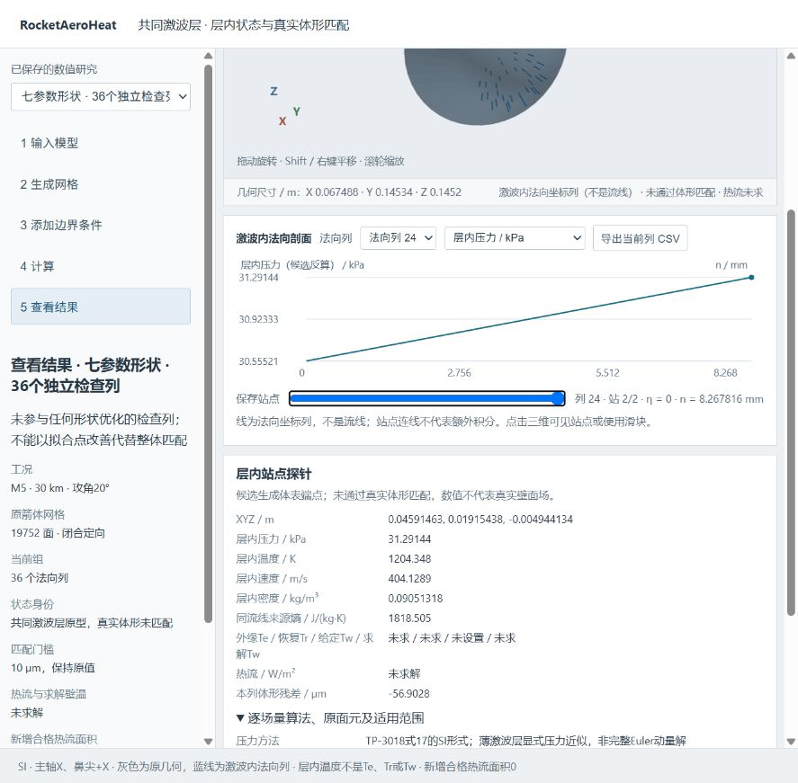
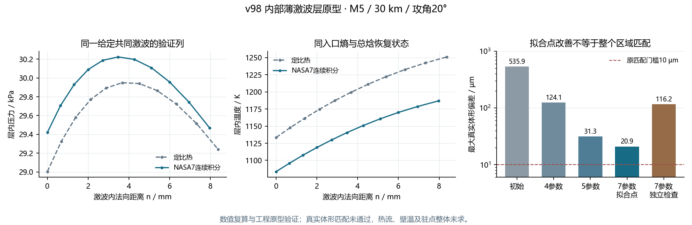

# v98 共同激波层原型：验证索引

本版已测试共同激波层的质量坐标、同流线来源熵、压力/速度近似与非正交法向距离，并实际反算真实20°箭体的共同激波形状。**拟合点及独立检查均未通过原10微米体形门槛，完整区域模型仍为草稿；没有新增正式壁压、边界层外缘、热流或壁温，新增合格热流面积为0。**

正式热流覆盖仍66.5626327424%，Q41仍19接受/82次主NS且未稳态。没有以本研究替代背风分离/再附、底面或大面积横流—收缩—后体的适用模型。

## 实际数值任务

所有下列进程均已实际终态，不能因源码仍为草稿就重复启动。

| 任务 | 实际结果 |
| --- | --- |
| parabolicLayer98 | exit1，来源稳定；迭代历史的空结构字段不兼容，保存原源码和日志后修复 |
| parabolicLayerHistory98 | 引擎21708，terminal/exit0/来源稳定；4参数真实拟合与两物性列完成，体形未匹配 |
| conicLayer98 | exit1，来源稳定；第5参数新增后，有限差分扰动向量仍为4维，保存原源码和日志后修复 |
| conicLayerDimension98 | 引擎27264，terminal/exit0/来源稳定；5参数真实拟合完成，体形未匹配 |
| translatedConic98 | 引擎41188，terminal/exit0/来源稳定；7参数、9拟合列及36个未参与拟合的检查列完成，均未通过门槛 |
| shockLayerView98 | 引擎51672，terminal/exit0/来源稳定；从冻结MAT导出首版研究视图，不重算层内场或形状 |
| shockLayerViewLarge98 | 引擎51040，terminal/exit0/来源稳定；放大三维区与修正横轴单位布局，数值JSON字节不变 |
| shockLayerViewWorkflow98 | 引擎39132，terminal/exit0/来源稳定；最终view03，切换流程复位滚动并使范围控件与实际视图一致 |

原始进程与stdout在`raw/`。两次数值编程失败前所有与当前不同的来源原文按精确SHA绑定，见`raw/failed_source_bindings.json`；没有改变物理公式或匹配门槛。首版视图的实际浏览发现三维区域偏小及横轴单位重叠，修订前原文在`raw/source_epochs/`。三个视图任务的数值JSON逐字节完全相同；八个实际进程的全部来源均已核对为当前版本或精确SHA的保留原文，其中10项旧版本关联另见`raw/all_process_source_audit.json`。

## 科研视图验收

最终view03保留同一侧栏的五步骤，支持完整19,752面原箭体与2,318面鼻部开放片、四组/47列/112站点、实际三维点选、站点滑块、五个层内场量曲线及CSV。灰色底图不按候选值涂成正式壁面云图，法向列不是表面流线，层内温度不称Te、Tr或Tw。此视图只是已保存研究的查看流程，不代表完整主程序的模型导入/实时求解功能已经新增。

- `raw/node_study_workflow.json`：20步骤事件、112站点与112行/47次CSV导出、24项过期/无关消息拒绝、滚动复位与范围控件身份通过。
- `raw/workbench_values_workflow.json`：原V/F、鼻部原三角面子集、全部列/站点数值、方法、原面号/重心权及未知热量与冻结MAT逐值完全相同。
- `raw/browser_final.json`：最终真实浏览器五步骤/四组切换、独立检查列24第2站点选、NASA7列1第6站滑块、逐变量方法展开和旋转，保留原观察。
- `raw/browser_export_audit.json`：两份真实下载的13行CSV的全部数值与冻结MAT完全相等，两个探针按其7位有效数字显示核对；未知热流/温度没有补零。
- 浏览器仍有一条与既有v94控制页同签名的MutationObserver诊断，原记录保留，未宣称完全归因或控制台干净；上述实际交互及数值验证与此诊断分开记录。



## 真实体形结果

| 共同曲面族 | 全局参数数 | 9拟合点RMS / µm | 最大拟合偏差 / µm |
| --- | ---: | ---: | ---: |
| 初始抛物面 | 4 | 325.750 | 535.939 |
| 迭代抛物面 | 4 | 71.309 | 124.099 |
| 纵向二次曲线 | 5 | 14.695 | 31.288 |
| 顶点横向位置也参与反算 | 7 | 11.814 | 20.921 |

最后一族在三个新半径、十二个周向角的36个独立点上，RMS为60.203微米、最大116.199微米。这些点不进入优化。不能继续靠逐点自由度或放宽门槛宣称区域匹配。



## 独立校核与冻结证据

`tests/data/shock_layer_transport/`包含三份小型原始MAT：

| 文件 | 字节数 | SHA256 |
| --- | ---: | --- |
| parabolic_shock_layer_evidence.mat | 455790 | `8d6365f482e8315066d4b1ff2ab51055e24099abadb7a47dbbeb618ac0be4f79` |
| conic_shock_layer_evidence.mat | 432952 | `74108c227c085e99801ab217637c904c7744fbc01a0a9029dcfc6573616a31a5` |
| translated_conic_layer_evidence.mat | 548078 | `b6da829135bd22ad2e2a76e0c0d0a2e73a6d6f7c9f66a5cc13d6025395bd5a46` |

三次冻结路径独立校核分别覆盖20、20、54列，包含重复数学列，不能相加称94个独立真实工况。用独立Brent根、QUADPACK积分、二次基本形式及原三角面平面交点/重心方程，不复用保存的Gauss质量积或曲率矩阵。七参数全部54列的最大相对状态差1.85126913799e-12、最大法向距离差1.12307509126e-9m；这些是同模型数值复算差异，不是实验精度。

来源SHA分别核对1135、1140、1143项。完全气体/NASA7、同流线来源熵、积分加密、非正交项、刚体变换、拒绝及B=0全部载荷逐值退化均有原测试依据。q=0有限列显式拒绝，不把驻点熵极限当作驻点整体/脱体距离已解。

原始复制清单为`raw/copied_evidence_manifest.json`；冻结路径复核为`raw/frozen_*_audit.json`。源论文为[NASA TP-3018 / NTRS 19900017750](https://ntrs.nasa.gov/citations/19900017750)，本轮没有实验验证。完整方程、SI单位与取向说明见[方法草稿](../../SHOCK_LAYER_TRANSPORT_V98_DRAFT.md)。

## 复现

只读审核不需要MATLAB、大型旧结果或外部CFD；报告路径必须尚不存在：

```text
python tests/auditParabolicShockLayer.py tests/data/shock_layer_transport/parabolic_shock_layer_evidence.mat docs/validation/v98/raw/parabolicLayerHistory98_process.json --report outputs/parabolic_audit_new.json
python tests/auditEllipticConicShockLayer.py tests/data/shock_layer_transport/conic_shock_layer_evidence.mat docs/validation/v98/raw/conicLayerDimension98_process.json --report outputs/conic_audit_new.json
python tests/auditTranslatedConicShockLayer.py tests/data/shock_layer_transport/translated_conic_layer_evidence.mat docs/validation/v98/raw/translatedConic98_process.json --report outputs/translated_audit_new.json
```

完整MATLAB函数均已直接更新，中文注释说明各模块用途。需要重算时在新目录调用：

```matlab
setupEngineeringShockLayer; addpath('tests');
testParabolicShockLayer('outputs/layer_new', ...
    'tests/data/shock_layer_entry/actual_rocket_geometry_and_freestream.mat');
testEllipticConicShockLayer('outputs/conic_new', ...
    'outputs/layer_new/parabolic_shock_layer_evidence.mat');
testTranslatedConicShockLayer('outputs/translated_new', ...
    'outputs/conic_new/conic_shock_layer_evidence.mat');
```

查看已保存数值，无需重新拟合：

```matlab
setupEngineeringShockLayer;
exportShockLayerStudy( ...
    'tests/data/shock_layer_transport/parabolic_shock_layer_evidence.mat', ...
    'tests/data/shock_layer_transport/conic_shock_layer_evidence.mat', ...
    'tests/data/shock_layer_transport/translated_conic_layer_evidence.mat', ...
    'outputs/shock_view_new');
```

通过本地HTTP服务打开生成的`workbench/index.html`即可完全离线查看，不依赖外部资源。例如在工程根目录执行`python -m http.server 8779 --bind 127.0.0.1 --directory outputs/shock_view_new`，然后访问`http://127.0.0.1:8779/workbench/index.html`。压力、温度、速度方法逐列显示；法向距离n、质量比eta与表面流线s区分，Te/Tr/给定Tw/求解Tw/热流明确未求。几何底图没有候选物理云图着色。

后续源码若变化，应按新实际任务重新绑定；不能直接用旧进程回执证明新源码。此次只同步源码、必要小输入及小型证据，不生成工程ZIP或重复全工程副本。
