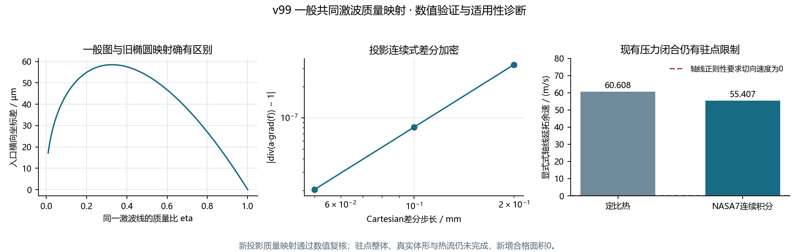

# v99 一般共同曲面质量映射：验证索引

一般凸共同激波图的投影质量与同流线入口映射已实现并通过独立数值复核。完整区域仍为原型：固定整体形变没有改善真实体形匹配，且本轮定位到当前显式一阶压力的轴线能量限制。**没有新增正式壁面压力、外缘、热流或壁温，正式热流覆盖仍66.5626327424%，本轮新增0；总目标active。**

## 任务与状态

| 任务 | 结果 |
| --- | --- |
| generalMass99 | 引擎38716，terminal/exit1/来源稳定；物理断言已走到最后拒绝检查，但本机负输入错误标识为`MATLAB:notGreaterEqual`，测试误写为另一标识；未产生最终MAT |
| generalMassIdentity99 | 引擎3716，terminal/exit0/来源稳定；只修正拒绝标识并增加报告前检查点，物理公式/阈值未改 |
| generalBody99 | 引擎38596，terminal/exit0/来源稳定；同一原19,752面、M5/30km/alpha20上45个位置，固定整体形变，无新拟合 |

原失败进程、stdout和修改前测试源码在`raw/first_failure_binding.json`绑定。首轮独立审核遇到保存整数K取负时无符号回绕、随后二维cell内`mat_struct`未转换，均修复审核器后复核；原文与说明在`raw/source_revision_bindings.json`，没有修改数值MAT、计算算法或放宽容差。全部实际MATLAB和Python任务均已终态，不重复启动旧任务。

## 已核验内容

- 四列退化回原抛物面/二次曲线和两种热物性；一般映射与旧解析路径用严格数值门槛比较，不宣称逐位相等。
- 非椭圆整体形变、同流线不同列来源、网格/积分加密、长度单位缩放和非凸/假驻点/有限驻点列/负质量比拒绝。
- Cartesian投影连续式差分：1.00000032、1.00000008、1.00000002，步长减半约二阶改善；入口相对旧椭圆映射变化37.820微米，同一来源差3.133e-14m。
- 独立可分离四次图闭式轨迹与Jacobian的QUADPACK/Brent复核，源点差9.267e-14m。
- 独立DOP853全2×2变分轨迹、实际投影通量积分、压缩跃迁、入口熵、曲率、状态、非正交厚度和原面平面/重心几何复算。

| 冻结审核 | 数学列/真实列 | 最大相对状态差 | 最大来源坐标差 / m | 最大厚度差 / m |
| --- | ---: | ---: | ---: | ---: |
| frozen_mass_audit.json | 6 | 3.4272e-11 | 1.5032e-13 | 3.1154e-11 |
| frozen_body_audit.json | 45 | 5.1650e-10 | 3.6719e-13 | 2.1646e-11 |

分别核对1161/1160项实际来源，审核器旧版本按精确SHA原文关联。上述为同模型数值验证，不是实验精度；投影连续式不代表完整体积连续式及所有三维动量已求解。

真实共同曲面在原9个位置与36个独立位置的最大体形偏差170.222/187.519微米，未通过原10微米门槛；`newShapeFits=0`，没有把这次固定形变称为新的拟合改进。真实列只保存完整物理量与质量摘要，完整回溯网格只在数学核验中保留，避免累积旧矩阵缓存。



## 新定位的轴线限制

`raw/axis_limit_audit.json`由冻结输入及独立正常激波/热物性求根计算：显式一阶压力在轴线端点比精确同熵驻止压力低0.4700%/0.4192%，由完整总焓恢复后留下60.608/55.407m/s切向余速。记录保留了激波端微小舍入余量，没有裁剪能量或补值。它诊断当前近似的解析延拓，不是计算出的真实驻点场。

下一步应建立含密度变化、入口熵及非正交几何的法向动量/质量闭合，先通过驻点正则性与独立轴线极限，再推进真实体形和跨声速。流向法向速度导数等项须保留或明示额外近似，不能只调整形状或省项后称完整三维Euler解。推导和范围见[方法说明](../../GENERAL_SHOCK_SURFACE_MASS_V99.md)。本轮未修改v98科研视图、原生产外流/物性/网格或Q41；Q41仍19接受/82主NS未稳态。

## 冻结数据与复现

小型原MAT在`tests/data/shock_surface_mass/`：数学证据2,751,651字节，SHA `1ac9d5ad84841b80219c9bf8273d1f2704777adeb6fec47cae68b5b4fed526d2`；真实体形证据566,487字节，SHA `52c13b990126ab576255439be8cdcd62831f65f2b30f8f781b447be9daaf3e7a`。复制清单及原回执在`raw/`，没有大型旧NS输入或外部CFD数据。

只读审核无需MATLAB，报告路径必须尚不存在：

```text
python tests/auditGeneralShockSurfaceMass.py tests/data/shock_surface_mass/general_mass_evidence.mat docs/validation/v99/raw/generalMassIdentity99_process.json --report outputs/general_mass_audit_new.json
python tests/auditGeneralShockSurfaceMass.py tests/data/shock_surface_mass/general_body_evidence.mat docs/validation/v99/raw/generalBody99_process.json --report outputs/general_body_audit_new.json
python tests/auditThinLayerAxisLimit.py tests/data/shock_layer_transport/parabolic_shock_layer_evidence.mat --report outputs/axis_limit_new.json
```

重算使用项目完整MATLAB文件和新目录：

```matlab
setupEngineeringShockLayer; addpath('tests');
testGeneralShockSurfaceMass('outputs/general_mass_new', ...
    'tests/data/shock_layer_transport/parabolic_shock_layer_evidence.mat', ...
    'tests/data/shock_layer_transport/conic_shock_layer_evidence.mat');
studyGeneralShockLayerBody('outputs/general_body_new', ...
    'tests/data/shock_layer_transport/translated_conic_layer_evidence.mat');
```

全部修改文件使用中文模块用途注释。方法为内部工程薄激波层原型，当前质量映射范围是凸单值共同图，不能用于未处理的鞍点、分离/再附或底面。源码、小型证据和最新目标随GitHub交付，不生成工程ZIP或重复全工程副本。

阶段结束又逐项核对数学中间检查点的15个变量，均已完整保留在最终MAT，数组类型、形状与数值字节完全相等。因此按用户既有授权回收这份冗余检查点，磁盘空闲实增2,752,512字节；最终证据、冻结副本和所有失败原文保留。详见`raw/checkpoint_retention_check.json`与`raw/checkpoint_cleanup.json`。真实列未保存全套回溯网格，不默认累积可重建大缓存。
